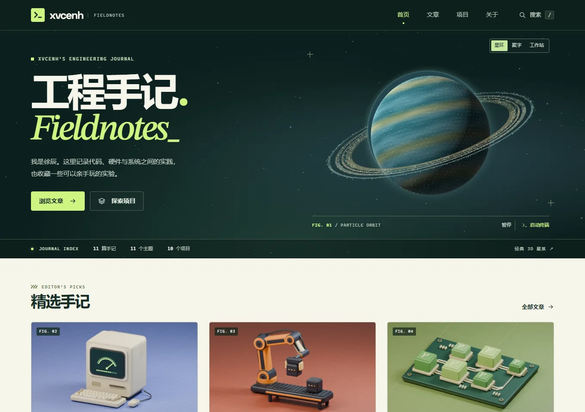

# xvcenh · 工程手记

徐辰的个人技术博客与交互实验室。首页是一片可以拖动的星空。星环可以聚成名字，也能切换到 CRT 工作站，通过终端查找手记。

[访问博客](https://xvcenh.github.io/) · [文章档案](https://xvcenh.github.io/issues/) · [项目实验室](https://xvcenh.github.io/projects/) · [漫游经典星系](https://xvcenh.github.io/galaxy/) · [订阅 RSS](https://xvcenh.github.io/feed.xml)



## 本地运行

需要 Ruby 3.3 与 Bundler。使用 Python 3 验证页面与资源链接，使用 Node.js 验证五连杆几何。

```sh
bundle install
bundle exec jekyll serve
```

浏览器打开 `http://127.0.0.1:4000/`。完整构建与检查命令如下。

```sh
bundle exec jekyll build --strict_front_matter
python scripts/check_site.py
node scripts/check_kinematics.mjs
```

## 更新内容

- **文章**存放于 `_posts/YYYY-MM-DD-slug.md`。设置 `title`、`date`、`author`、`categories` 和可选的 `keywords`。文章档案、分类总表、全文搜索和 RSS 随构建更新。
- **项目**由 `_data/projects.yml` 维护。每项可包含在线演示与 GitHub 仓库。精选文章的顺序和封面在 `_data/features.yml` 中设置。
- **前端**使用共享的 Jekyll 布局和原生 JavaScript。首页的 Canvas 星环在后台线程绘制行星表面，支持暂停、拖动与减少动态效果。经典星系单独加载随仓库提供的 Three.js。文章日历、阅读进度、项目实机预览和可键盘操作的技术星图均可从主导航访问。
- **发布**由 GitHub Actions 完成。详见[发布说明](GITHUB_PAGES_SETUP.md)。

## 设计参考与素材

精选文章和时间档案的组织参考 MIT 许可的 [Astro Cactus](https://github.com/chrismwilliams/astro-theme-cactus)。让访问者操纵场景的交互思路参考 [Bruno Simon 的作品集](https://www.cssdesignawards.com/woty2025/sites/brunos-portfolio/)。工作站与三张手记封面为本次重构制作。自托管字体与 Three.js 的许可分别位于 `assets/fonts/` 和 `assets/vendor/three/`。
